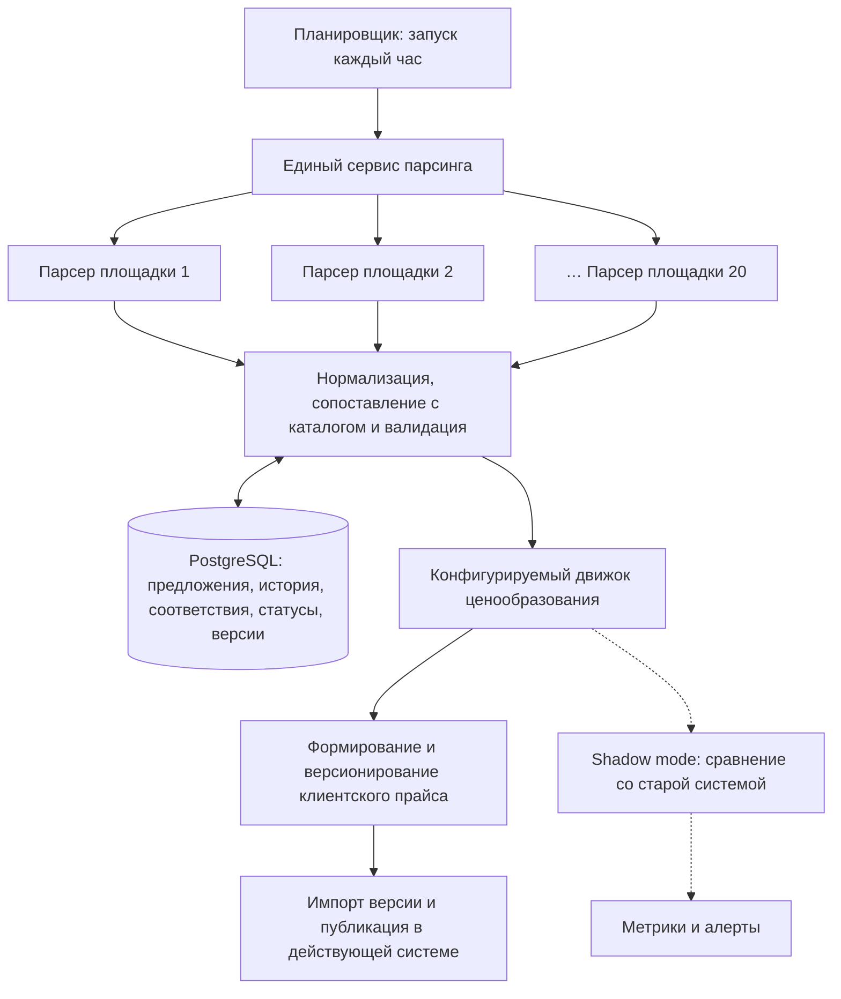

# Автоматизация сбора цен конкурентов и обновления клиентских прайсов

## Исходная ситуация

Компания продаёт автозапчасти. Действующая система формирует клиентские прайсы. Цены конкурентов собираются примерно с 20 площадок, после чего результаты передаются через Excel. Новая система сбора работает локально, но ещё не запущена в продакшен. Документация есть, предыдущий разработчик доступен для консультаций. Поддерживать обе системы предстоит новому разработчику.

**Бизнес-цель:** получать актуальные цены конкурентов каждый час и автоматически обновлять клиентские прайсы.

**Ограничения:** ошибочные данные могут привести к неверным ценам; действующую систему останавливать нельзя.

---

## 1. Пять вопросов перед началом реализации

**Влияние ответов на архитектуру раскрыто для двух наиболее важных вопросов — №1 и №2.**

### 1. Какие стратегии ценообразования необходимы и насколько гибко ими должен управлять бизнес?

Как сейчас рассчитываются цены: по минимальной или средней цене конкурентов, себестоимости, заданной марже, спросу, остаткам или сочетанию факторов? Нужны ли разные правила для отдельных товаров, категорий, клиентов и периодов? Разделяются ли **базовая цена**, **скидка** и **итоговая цена**? Возможно ли временное исключение из ограничений по маржинальности — например, новогодняя распродажа неликвида ниже себестоимости? Кто вправе создавать и утверждать такие исключения?

**Один из двух приоритетных вопросов.** От выбранной стратегии зависит возможность безопасно публиковать цены автоматически и степень свободы бизнеса при проведении акций.

**Как ответы влияют на архитектуру (приоритетный вопрос №1):**

- **Правила формализованы →** выделяем конфигурируемый `pricing engine`, независимый от парсеров: данные о стратегии, области применения, приоритетах и сроках действия храним в БД, а не зашиваем в код. **Правила не определены →** движок может рассчитывать предложения, но публикация остаётся в `shadow mode` до утверждения бизнес-логики.
- **Разрешены акции ниже себестоимости →** нужны отдельный контур промо-правил, механизм приоритетов/переопределений, согласование через RBAC и аудит. **Запрещены →** минимальная маржинальность становится безусловным ограничением.
- **Есть надёжные данные о спросе, остатках и истории →** закладываем дополнительные входы для адаптивных алгоритмов и `backtesting`. **Нет →** используем простые объяснимые правила, но накапливаем историю для будущего усложнения.
- **Базовая цена и скидка разделены →** сохраняем их независимо. **Не разделены →** вводим отдельные сущности базовой цены, акции/скидки и итоговой цены, с версиями и периодами действия.

**Архитектурный итог:** сбор цен → валидация → независимый движок правил → согласование исключений (при необходимости) → публикация версии прайса. Так акции можно менять без релиза парсеров и без неконтролируемого изменения базовой цены.

---

### 2. Как сопоставляются товары нашего каталога с каталогами конкурентов и проверяется корректность совпадений?

По каким признакам выполняется сопоставление: внутренний SKU, OEM-номер, артикул производителя, бренд, название, применимость? Как обрабатываются опечатки, разные написания названий, альтернативные OEM, аналоги, дубликаты и неоднозначные совпадения? Все ли найденные на сайтах товары есть в нашем каталоге? Что делать с отсутствующими позициями? Сбор идёт от собственного каталога к сайтам или сначала собираются предложения с сайтов с последующим сопоставлением?

**Один из двух приоритетных вопросов.** Неверное соответствие двух деталей делает бессмысленным даже идеально рассчитанное ценообразование.

**Как ответы влияют на архитектуру (приоритетный вопрос №2):**

- **Есть стабильные SKU и внешние артикулы →** достаточно справочника соответствий и точного сопоставления. **Нет стабильных SKU →** сначала нужен канонический мастер-каталог; автоматическое ценообразование по спорным товарам не запускаем.
- **Названия отличаются или содержат опечатки →** выделяем этап нормализации и сервис `matching`: точный поиск, затем `fuzzy matching` как поиск кандидатов, проверка производителя, OEM, комплектации и применимости. Неоднозначные совпадения идут в очередь ручной проверки.
- **Несколько источников подтверждают или опровергают атрибуты →** храним происхождение (`provenance`), версии названий/OEM и подтверждённые алиасы. Внутренний каталог остаётся источником истины по нашим SKU; внешние данные не перезаписывают его автоматически.
- **Собираем все предложения конкурентов →** потребуется отдельный поток загрузки внешнего каталога и более масштабный `matching`. **Ищем цены только по своим SKU →** можно строить задачи сбора вокруг внутреннего каталога и отслеживать покрытие.

**Архитектурный итог:** парсеры → нормализация → сопоставление с каталогом и независимая проверка → статус достоверности → pricing engine. В расчёт и публикацию допускаются только подтверждённые совпадения; товары, которых нет у нас, хранятся отдельно для аналитики.

---

### 3. Сохраняются ли исторические данные и как организован жизненный цикл цен?

Есть ли история собранных цен конкурентов, наших базовых и акционных цен, изменений правил, применённых скидок и опубликованных клиентских прайсов? Где она хранится, с какой детализацией и глубиной? Хранятся ли время сбора, источник и признаки качества? Можно ли восстановить причину конкретного изменения цены и откатиться на предыдущую версию?

---

### 4. Как устроены хранение, интеграция и разграничение доступа к ценовым данным?

Excel — лишь обменный формат или фактически основное хранилище? Есть ли API/БД для передачи цен в работающую систему? Кто имеет доступ к файлам и прайсам, кто может просматривать, редактировать, утверждать и публиковать цены? Существует ли **role-based access control (RBAC)** и аудит действий? Есть ли тестовая среда, возможность параллельной работы двух систем и механизм восстановления прежней версии прайса?

**Уточнение.** Для автоматического импорта нужен способ передать идентификатор версии, проверить её статус в действующей системе и прочитать фактически опубликованный прайс. Транзакция PostgreSQL защищает записи нового контура. Применение версии и защиту от повторной публикации обеспечивает принимающая сторона.

---

### 5. Какие требования к почасовому обновлению, полноте сбора и отказоустойчивости?

Сколько SKU и предложений нужно обрабатывать за час, как долго сейчас длится сбор с ~20 площадок? Что происходит при падении парсера посреди обработки, таймауте, HTTP 429/5xx, изменении вёрстки сайта или недоступности площадки? Есть ли **retry**, сохранение прогресса, повторный запуск без дублей и оповещения? Можно ли публиковать частично обновлённый прайс, как долго допустимо использовать последние проверенные цены?

---

## 2. Допущения для дальнейшего проектирования

Для дальнейшего решения задачи **принимаем следующие допущения за истинные**. Дополнительные ответы от заказчика в рамках задания не требуются.

1. **Текущая система продолжает работать без остановок.** Она остаётся единственной точкой публикации клиентских прайсов. При пилотном переключении меняется источник цен для выбранных позиций.
2. **Новый парсер можно развернуть параллельно с текущей системой.** Сначала он работает в `shadow mode`: собирает и рассчитывает цены, но не меняет действующие клиентские прайсы.
3. **У товаров внутреннего каталога есть устойчивые SKU.** Для идентификации запчастей также доступны производитель, артикул и/или OEM; одного совпадения по названию недостаточно.
4. **Внешние каталоги содержат опечатки, альтернативные OEM и неполные атрибуты.** Для автоматической переоценки допускаются только подтверждённые соответствия; спорные и отсутствующие у нас товары не участвуют в обновлении цен.
5. **Бизнесу нужны конфигурируемые стратегии ценообразования.** Стандартные ограничения по маржинальности действуют по умолчанию; согласованные акции (например, распродажа неликвида) могут временно переопределять их по заданным SKU и срокам. Базовая цена, скидка и итоговая цена учитываются раздельно.
6. **Почасовое обновление означает запуск сбора по расписанию раз в 60 минут.** Для каждого SKU в пилоте заранее задан набор площадок, участвующих в расчёте. Для автоматического обновления нужны полные результаты текущего цикла от всех площадок из этого набора и хотя бы одно валидное предложение по подтверждённому соответствию. Сбор завершается к заданному сроку, активные циклы сбора не пересекаются.
7. **Полноценная история цен может отсутствовать или быть неполной.** Новый контур с первого запуска сохраняет наблюдения конкурентов, время и источник сбора, изменения правил, расчёты и версии опубликованных прайсов.
8. **PostgreSQL используется как основное хранилище нового контура.** Excel можно сохранить как временный формат передачи. Пока действующая система не умеет проверять версию и безопасно обрабатывать её повтор, импорт Excel остаётся ручным.
9. **Сбои отдельных парсеров не должны останавливать весь сбор.** Предусматриваются ограниченные повторы, восстановление с контрольной точки и уведомления. По затронутым SKU сохраняем текущую опубликованную цену, пока новый цикл не даст полный набор результатов.
10. **Изменение правил и публикация цен контролируются.** Действуют RBAC, разграничение ролей, аудит и согласование рискованных исключений. Для автопубликации предполагаем, что действующая система умеет проверить базовую версию прайса, подготовить новую версию отдельно и переключить опубликованный прайс целиком. Этот контракт проверяем перед пилотом.

---

# 2. Простая архитектура

Для сопровождения одним разработчиком предлагается **модульная система на Python + PostgreSQL** без дополнительных микросервисов. Планировщик `cron` запускает **один сервис сбора**, внутри которого отдельный парсер отвечает за каждую из ~20 площадок.

## Пояснение (10 предложений)

1. Планировщик `cron` каждый час запускает **единый сервис парсинга**, внутри которого для каждой из ~20 площадок предусмотрен отдельный модуль с собственной логикой извлечения данных.
2. Сервис поддерживает ограниченные `retry` с `exponential backoff`, таймауты и `checkpointing`, позволяя возобновить сбор после сбоя.
3. Полученные предложения проходят **единый этап нормализации, сопоставления и валидации**: проверяются SKU, OEM, производитель, наличие позиции во внутреннем каталоге, актуальность и аномальные отклонения цен; `fuzzy matching` используется для поиска кандидатов, но не для автоматического подтверждения спорных совпадений.
4. Сырые данные, подтверждённые соответствия товаров, история цен, статусы обработки и версии прайсов сохраняются в **PostgreSQL** с транзакционностью и аудитом.
5. Валидные предложения передаются в **конфигурируемый движок ценообразования**, который учитывает себестоимость, цены конкурентов, маржинальность, остатки и утверждённые акционные стратегии.
6. Базовая и акционная цены хранятся раздельно, а управление стратегиями, исключениями и публикацией ограничивается через **RBAC**.
7. При недоступности площадки остальные парсеры продолжают работать, а затронутые позиции сохраняют текущие клиентские цены до следующего полного сбора.
8. При повторном запуске сервис продолжает тот же цикл с сохранённого этапа и проверяет статус импорта по идентификатору уже подготовленной версии прайса.
9. Новая система сначала запускается параллельно со старой в **`shadow mode`**, без изменения клиентских цен; сравниваются покрытие каталога, точность сопоставления, доля ошибочных цен, актуальность данных, успешность сбора и время обработки.
10. После достижения согласованных порогов метрик новый источник цен включается для пилотной группы через **feature flag**, а при проблеме действующая система восстанавливает затронутые цены и возвращает группу на прежний процесс.

### Сбой площадки

Для каждой площадки фиксируем результат по SKU в текущем цикле. Успешный поиск без предложений считается полным результатом. Таймаут, ошибка или неполный ответ после исчерпания повторов к сроку завершения сбора оставляют результат неполным. Если хотя бы одна площадка из набора для SKU не завершила поиск или ни одна не дала валидного предложения, сохраняем текущую клиентскую цену и записываем причину. Предложения из предыдущего цикла остаются в истории. Остальные SKU обновляются по обычным правилам. Например, если площадка с минимальной ценой не ответила, по затронутым позициям цена не изменится только потому, что в этом цикле видны более дорогие предложения.

### Повторный запуск цикла и импорт

Цикл однозначно определяется запланированным часом запуска в UTC. Повторный запуск получает исходный час и пытается захватить общую блокировку в PostgreSQL. Если другой запуск уже держит её, повтор завершается. После сбоя до срока завершения сбора повторяем только незавершённые задачи. Результат и контрольную точку сохраняем в одной транзакции по уникальному ключу «цикл, площадка, SKU». После закрытия сбора используем зафиксированные результаты. Если версия обновления уже подготовлена, находим её по циклу и прайсу и проверяем статус импорта. Для завершённого цикла без обновлений повторный запуск сразу завершается.

Перед отправкой сохраняем неизменяемую версию обновления с идентификатором, содержимым и номером базовой версии прайса, на которую рассчитано обновление. В той же транзакции привязываем подготовленную версию к циклу и прайсу. Действующая система регистрирует импорт по уникальному идентификатору, готовит обновление отдельно и при публикации проверяет, что базовая версия ещё актуальна. Переключение опубликованной версии и статус «применено» фиксируются вместе. Если подтверждение потерялось, сначала запрашиваем статус по идентификатору. Применённую версию считаем завершённой, импорт в работе ждём, а отсутствующий или подтверждённо неприменённый импорт повторяем с тем же идентификатором и содержимым, если базовая версия всё ещё актуальна. Если статус выяснить не удалось, оставляем импорт на сверке и приостанавливаем автоматические публикации для этого прайса до прояснения результата. Если версия подтверждённо не применена и базовый прайс успел измениться, пересчитываем обновление по актуальному прайсу, сохраняем его с новым идентификатором и обновляем привязку в той же транзакции.

### Откат пилота

В действующей системе отключаем приём обновлений от нового процесса для пилотной группы. Перед переключением опубликованной версии действующая система проверяет этот запрет, поэтому он действует и для импортов, которые уже были в очереди или в работе. Затем проверяем, какой импорт успел примениться. Если проблемная версия уже опубликована, берём цены затронутых позиций из последней подтверждённой корректной версии и публикуем их как новую версию прайса. Остальные цены берём из текущего прайса. Позиции с более поздними правками сверяем перед восстановлением, чтобы сохранить корректные изменения. После проверки фактически опубликованных цен возвращаем пилотную группу на прежний процесс. На остальных позициях действующая система продолжает работать в обычном режиме.

## Метрики для сравнения новой и старой систем

| Метрика | Что оцениваем |
|---|---|
| **Catalog Coverage** | Доля SKU нашего каталога, для которых найдены предложения конкурентов. |
| **Matching Precision** | Доля корректных сопоставлений SKU/OEM на вручную проверенной выборке. |
| **Data Freshness** | Возраст последней достоверной цены конкурента. |
| **Parsing Success Rate** | Доля успешно выполненных задач сбора по площадкам. |
| **Price Error Rate** | Доля ошибочно рассчитанных цен на проверенной выборке. |
| **Processing Latency** | Время от запуска сбора до готовности и публикации нового прайса. |

**Критерий успеха:** сравнивать не только совпадение цен с предыдущей системой, но и проверять корректность на независимой выборке, поскольку старый процесс тоже может содержать ошибки.

**Почему этот стек:** Python — существующие парсеры и бизнес-логика; PostgreSQL — надёжное хранение, история и транзакции; `cron` — достаточный по сложности инструмент для почасового запуска; `FastAPI` можно использовать для API управления и интеграции, если он действительно требуется. Kafka, Kubernetes и отдельные микросервисы на первом этапе не нужны.

---

## Сокращения и термины

- **SKU (Stock Keeping Unit)** — внутренний уникальный идентификатор товарной позиции.
- **OEM (Original Equipment Manufacturer)** — производитель оригинального оборудования; **OEM-номер** — номер детали в каталоге производителя.

